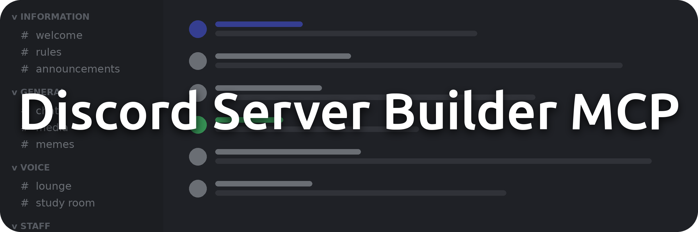

<div align="center">

<p align="center">
  
</p>

<p align="center"><a href="README.md">English</a> | <b>日本語</b></p>

<h1 align="center">Discord Server Builder MCP</h1>

<h3 align="center">AI に、自分の Bot 経由で Discord サーバーの構成を組ませる。</h3>

<p align="center">AI アシスタント（Claude など）に、Discord サーバーのカテゴリ・チャンネル・ロール・権限を扱わせる MCP サーバーです。Discord の REST API だけを使うため、特権インテントは要らず、Bot をオンラインにしておく必要もありません。</p>

<p align="center">
  <a href="https://www.npmjs.com/package/diserverbuilder-mcp"></a>
  <a href="https://github.com/Lapius7/diserverbuilder-mcp/releases"></a>
  <a href="https://github.com/Lapius7/diserverbuilder-mcp/actions/workflows/ci.yml"></a>
  <a href="LICENSE"></a>
  <a href="https://modelcontextprotocol.io"></a>
  <a href="https://discord.com/developers/docs"></a>
  <a href="https://github.com/Lapius7/diserverbuilder-mcp/stargazers"></a>
</p>

<p align="center">
  <a href="#セットアップ">セットアップ</a> · <a href="#ツール95-個">ツール</a> · <a href="#環境変数">環境変数</a> · <a href="#安全のために">安全のために</a>
</p>

</div>

---

## ツール（95 個）

<details>
<summary>全ツール</summary>

| 分野 | ツール |
|------|--------|
| 概要 | `list_guilds`、`get_guild_info`、`get_structure`、`edit_guild`、`get_audit_log` |
| チャンネル | `create_category`、`create_channel`（テキスト、ボイス、アナウンス、ステージ、フォーラム、メディア）、`edit_channel`（スローモード、ボイスの上限、フォーラムタグ）、`reorder`、`clone_channel`、`delete_channel` |
| 権限 | `get_permissions`、`set_permissions`、`clear_permissions`、`sync_permissions`（カテゴリの権限を配下に揃える） |
| ロール | `list_roles`、`create_role`、`edit_role`、`delete_role`、`reorder_roles`、`apply_roles`、`add_member_role`、`remove_member_role`、`search_members`、`list_role_members` |
| 構成の一括反映 | `apply_layout`（構成全体を宣言。既存のものの権限も揃えられる）、`export_layout`（書き出して `apply_layout` に戻しても差分が出ない） |
| バックアップ | `snapshot`、`list_snapshots`、`diff_snapshot`、`restore_snapshot`（別サーバーへの構成コピーにも使える） |
| メンバー | `get_member`、`kick_member`、`ban_member`、`unban_member`、`list_bans`、`timeout_member`、`set_nickname`、`move_member` |
| AutoMod | `list_automod_rules`、`create_automod_rule`、`edit_automod_rule`、`delete_automod_rule` |
| コミュニティ | `get_onboarding`、`edit_onboarding`、`get_welcome_screen`、`edit_welcome_screen`、`enable_community`、`disable_community` |
| 絵文字とステッカー | `list_emojis`、`create_emoji`、`delete_emoji`、`list_stickers`、`create_sticker`、`delete_sticker` |
| 招待、Webhook、イベント | `list_invites`、`create_invite`、`delete_invite`、`list_webhooks`、`create_webhook`、`execute_webhook`、`delete_webhook`、`list_events`、`create_event`、`delete_event` |
| メッセージ | `send_message`（本文、埋め込み、投票、リンクボタン、返信、ピン留め）、`edit_message`、`delete_message`、`pin_message`、`get_messages`、`add_reaction`、`remove_reaction`、`purge_messages` |
| 権限の点検 | `check_access`（メンバーやロールが各チャンネルで実際にできること）、`audit_permissions`（危険な権限、同名のロール、削除済みロールの権限、Bot のロールの順序） |
| テンプレート（ローカル） | `list_templates`、`save_template`、`apply_template`。組み込みは minimal、gaming、study、creator、support |
| サーバーテンプレート（Discord） | `list_guild_templates`、`get_guild_template`、`create_guild_template`、`sync_guild_template`、`edit_guild_template`、`delete_guild_template` |
| アクティビティ | `inactive_channels`、`activity_report` |
| ステージ | `get_stage`、`start_stage`、`edit_stage`、`end_stage` |
| スレッドとフォーラム | `create_forum_post`、`create_thread`、`list_threads`、`edit_thread`、`set_forum_options`（タグは `edit_channel` で設定する） |

</details>

ボタンはリンクボタンだけです。ゲートウェイに接続しないため、ほかの種類のボタンは押されても受け取れません。

メンバーの一覧を取るとき（`search_members`、`list_role_members`、`includeMembers` つきの `snapshot`）は、**Server Members Intent** が必要です。Developer Portal の Bot ページ（Privileged Gateway Intents）でオンにしてください。オフのときは、ツールがその旨を伝えます。

## セットアップ

### 1. Bot を作る

1. [Discord Developer Portal](https://discord.com/developers/applications) でアプリケーションを作り、Bot を追加します。
2. Bot のトークンをコピーします（Bot → Reset Token）。外に出さないでください。
3. 次のどちらかの URL で Bot をサーバーに招待します（`YOUR_CLIENT_ID` を置き換え）。

構成の操作だけ（チャンネルの閲覧、チャンネルの管理、ロールの管理）:

```
https://discord.com/oauth2/authorize?client_id=YOUR_CLIENT_ID&scope=bot&permissions=268436496
```

すべてのツール（上に加えて、サーバー管理、Webhook の管理、イベントの管理、絵文字の作成と管理、招待の作成、監査ログの表示、メッセージの送信、埋め込みリンク、メッセージ履歴の閲覧、メッセージの管理、ピン留め、公開スレッドの作成、スレッドでのメッセージ送信、スレッドの管理、メンバーのキック、メンバーの BAN、メンバーのタイムアウト、メンバーの移動、メンバーのミュート、リアクションの追加、投票の作成、ニックネームの管理）:

```
https://discord.com/oauth2/authorize?client_id=YOUR_CLIENT_ID&scope=bot&permissions=2824982413536503
```

権限が足りないツールは、その旨のエラーを返して失敗するだけなので、まず小さいほうから始められます。

Bot のロールは操作したいロールより上に置いてください。Discord の仕様で、Bot は自分より上のロールを編集できず、自分が持たない権限も付与できません。

### 2. MCP クライアントに登録する

Claude Code:

```sh
claude mcp add -s user diserverbuilder -- npx -y diserverbuilder-mcp
```

Claude Desktop（`claude_desktop_config.json`）:

```json
{
  "mcpServers": {
    "diserverbuilder": {
      "command": "npx",
      "args": ["-y", "diserverbuilder-mcp"]
    }
  }
}
```

### 3. Bot のトークンを保存する

```sh
npx diserverbuilder-mcp auth
```

トークンを入力すると（画面には表示されません）、Discord で有効か確かめてから、自分だけが読める `~/.diserverbuilder/config.json` に保存します。トークンはシェルの履歴にも、MCP の設定にも、チャットにも残りません。トークンを再発行したときは、もう一度実行してください。`auth status` で使われるトークンの出どころを確認でき、`auth logout` で保存したトークンを削除できます。

環境変数 `DISCORD_BOT_TOKEN` で渡すこともできます（たとえば MCP の登録の `env`）。保存したトークンより優先されます。

Node.js 20 以上が必要です。

## トラブルシューティング

| メッセージ | 原因と対処 |
|------------|------------|
| `The bot token is invalid or was reset`（401） | トークンが間違っているか、リセットされています。Developer Portal（Bot → Reset Token）で新しいトークンを取り直し、`npx diserverbuilder-mcp auth` を実行してください。`DISCORD_BOT_TOKEN` を設定している場合は保存したトークンより優先されるので、そちらを直すか外してください。 |
| `The bot lacks a permission`（403） | 上の権限で Bot を招待し直し、Bot のロールを操作したいロールより上に置いてください。 |
| `Discord says the bot has no access`（50001） | Bot がそのサーバーにいないかチャンネルを見られません。または、操作に管理者権限が要ります（Discord テンプレート、コミュニティ）。 |
| `Not found`（404） | ID が違うか、別のサーバーのものです。`list_guilds`、`get_structure`、`list_roles` で調べてください。 |
| `No bot token` | `npx diserverbuilder-mcp auth` を実行するか、MCP の登録の `env` に `DISCORD_BOT_TOKEN` を設定してください。 |

トークンをチャットやログ、リポジトリに載せてしまったら、すぐに Developer Portal で再発行してください。

## 環境変数

| 名前 | 必須 | 説明 |
|------|------|------|
| `DISCORD_BOT_TOKEN` | いいえ | Bot のトークン。`auth` で保存したものより優先される。どちらか一方を設定する |
| `DISCORD_GUILD_ID` | いいえ | 既定のサーバー ID。未設定なら各ツールに `guildId` を渡す |
| `DISERVERBUILDER_CONFIG_DIR` | いいえ | `auth` がトークンを保存する場所。既定は `~/.diserverbuilder` |
| `DISERVERBUILDER_SNAPSHOT_DIR` | いいえ | スナップショットの保存先。既定は `~/.diserverbuilder/snapshots` |
| `DISERVERBUILDER_READONLY` | いいえ | `1` にすると、Discord を変更できないツールだけを登録する（見る・書き出すだけで、編集は不可） |
| `DISERVERBUILDER_TOOLS` | いいえ | 登録するツールのグループをコンマ区切りで指定する（例: `channels,roles,layout`）。既定はすべて。グループは `overview`、`channels`、`permissions`、`roles`、`layout`、`backup`、`members`、`automod`、`community`、`expressions`、`invites`、`webhooks`、`events`、`messages`、`audit`、`templates`、`guildtemplates`、`analytics`、`stages`、`threads`。未知の名前は stderr に表示され、有効な名前が1つもなければ全ツールを登録する。`DISERVERBUILDER_READONLY` と併用できる |

## 安全のために

- `apply_layout` は `dryRun: false` を渡すまで計画を表示するだけです。既存のチャンネルは名前で照合するので、重複して作らず、移動や更新で済ませます。
- 構成に書いていないチャンネルは触りません。削除されるのは `prune: true` かつ `dryRun: false` のときだけです。
- `apply_layout` を実際に実行する前に、スナップショットを自動で保存します。それ以外の大きな変更の前は `snapshot` を自分で呼んでください。
- `DISERVERBUILDER_READONLY=1` にすると、AI に中を見せるだけで、何も変更させずに済みます。
- `send_message` と `edit_message` は `allowMentions: true` を渡さない限り、`@everyone` などのメンションで通知しません。
- `apply_layout` は、既定では既存のチャンネルの権限に触りません。`syncPermissions: "merge"` にすると、宣言したビットを既存のものに足します（宣言したビットが優先され、それ以外は残ります）。`"replace"` にするとロールの権限が宣言と完全に一致するよう揃えます。宣言にないロールの権限は削除され、メンバー個別の権限は残ります。dry run では変更内容が1件ずつ表示されます。
- `export_layout` は、カテゴリなしのチャンネル、スローモード、ボイスの上限、フォーラムタグ、ロールごとの権限も書き出します。変更のないサーバーを書き出して反映すると「Nothing to change」になります。メンバー個別の権限は `includeMembers: true` のときだけ書き出し、未対応のチャンネル種別は書き出さず、メモに一覧します。メモに未対応の種別が出たときは、`prune: true` で反映すると、それらのチャンネルが削除されます。
- ロール名は大文字小文字を区別せずに照合します。同じ名前のロールが複数あるときは、推測せずにロール ID を求めて止まります。`apply_roles` はそのロールを飛ばします。
- `snapshot` は、サーバー設定、絵文字、ステッカー、予定イベント、AutoMod のルール、オンボーディング、ウェルカム画面も記録します。Bot が読めない部分は、メモを残して飛ばします。`diff_snapshot` で、スナップショットから何が変わったかを確かめられます。
- `kick_member`、`ban_member`、`timeout_member` は dry run がなく、すぐに実行されます。タイムアウトは最長 28 日、BAN では最大 7 日分のメッセージを同時に削除できます。理由は監査ログに残ります。
- `purge_messages` は既定が dry run です。新しいほうから最大 500 件を調べ、ピン留めされたメッセージは指定がない限り残します。14 日より古いメッセージは Discord が一括削除できないため、残します。削除したメッセージは元に戻せません。
- `edit_onboarding` は、渡した一覧で質問をすべて置き換えます。先に `get_onboarding` で現在の質問を読んでください。コミュニティ機能が必要です。
- `execute_webhook` に渡すのは Webhook の ID だけです。秘密のトークンはツールの中で取得し、エラーメッセージを含め、表示しません。
- `apply_roles` と `sync_permissions` も既定は dry run です。`apply_roles` はロールを削除しません。
- `restore_snapshot` は無いものだけを名前で照合して作り直し、既存のものは変更も削除もしません。既定は dry run です。
- Discord は一括呼び出しでは 1 件のチャンネルの親しか変えられません。`reorder` では複数のチャンネルをカテゴリ間で一度に動かせないので、その場合は `apply_layout` を使います。
- `delete_channel` と `delete_role` は現在の名前の完全一致を求めます。`delete_channel` はさらに、指定したサーバーに属することも確かめてから削除します。削除したチャンネルとメッセージは元に戻せません。スナップショットにメッセージは含まれません。
- `apply_template` はローカルのテンプレートを反映します。テンプレートにあるロールとチャンネルのうち無いものだけを作り、ほかは残します。既定は dry run で、実際に実行する前にスナップショットを保存します。大きなテンプレートは Discord のレート制限で 1 分を超えるため、タイムアウトが 60 秒の MCP クライアントではタイムアウトと表示されても処理は続きます。2 回目の実行では「変更なし」と報告します。Bot が自分で持っていない権限はロールに付けられないため、テンプレートがそれを求める場合は、何も変えずに拒否します（組み込みのロールは「すべてのツール」の招待リンクの範囲に収めています）。ステージチャンネルにはコミュニティサーバーが必要なので、先に `enable_community` を実行してください（dry run で知らせ、実際の実行はそのままでは拒否します）。`list_templates` と `save_template` が扱うのは手元のファイルだけです。Discord のサーバーテンプレート（`discord.new` のリンク）は `*_guild_template` のツールで、1 つのサーバーにつき 1 つまでで、2 つ目を作ると失敗します（コード 30031）。
- `check_access` と `audit_permissions` は読み取りだけです。`check_access` は Discord の順序（オーナーと管理者が先、次に @everyone とロール、チャンネルの権限、最後にメンバー）に従います。カテゴリの権限は配下のチャンネルに自動では届かないので、チャンネルを指定して確かめてください。
- `inactive_channels` と `activity_report` はメッセージの本文を返しません。レポートの任意のサンプルは、25 チャンネルまで、各チャンネル最新 100 件までしか読まないので、発言の多いチャンネルの件数は下限です。
- `enable_community` と `disable_community` は既定が dry run です。有効にすると、Discord の要件により認証レベルが上がり、不適切なコンテンツのフィルターがオンになることがあります。コミュニティのオンとオフ、`*_guild_template` のツールは、Bot のロールに管理者権限が必要で、付けられるのはサーバーのオーナーだけです。ステージのツールにはコミュニティサーバーが必要です。
- `end_stage` と `delete_guild_template` は、現在のトピックまたは名前の完全一致を求めます。
- トークンはそのサーバーのチャンネルとロールを管理できる権限を持ちます。リポジトリや共有の設定ファイルに入れないでください。`auth` は、自分だけが読めるファイルに保存します。

## 開発

```sh
pnpm install
pnpm run typecheck
pnpm test         # Bun が必要。Discord への接続もトークンも要らない
pnpm run build   # src/ を dist/index.js にまとめる（Bun が必要）
pnpm start       # dist/index.js を stdio で起動
```

## ライセンス

MIT
